<div align="center">


# StrawSlot

**Book the machine before the fire.**

A deadline-aware scheduler that books crop-residue machines, tractors and straw pickups<br/>before each farmer's sowing deadline, so small farmers don't burn paddy straw for lack of time.


[**How it works**](#how-it-works) · [**Screenshots**](#screenshots) · [**Run locally**](#run-locally)

<br/>

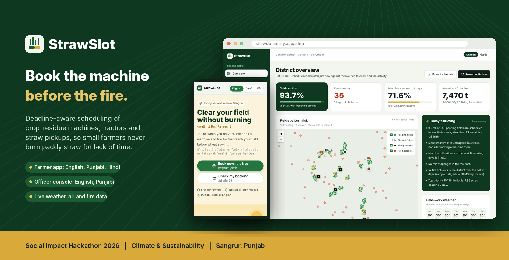

</div>

---

## 🔥 The problem

> **Small farmers burn paddy straw because no one schedules machines, tractors and pickups before each field's sowing deadline; apps only list machines.**

<table>
<tr>
<td width="33%" valign="top">

### ⏱️ 15–18 days
After paddy harvest, that's all the time a farmer has to clear straw and sow wheat. When the machine is late, fire is the only option that always works on time.

</td>
<td width="33%" valign="top">

### 🚜 3 things at once
Clearing needs a machine, a tractor strong enough to pull it (Super Seeder: 55 HP+), and for baling, a straw pickup. Small farmers often own none of these.

</td>
<td width="33%" valign="top">

### 📋 Listed, not scheduled
Booking apps show that machines exist, not whether one reaches *your* field *before your deadline*. Field studies (CEEW) blame delays and uncertainty.

</td>
</tr>
</table>

---

<a id="how-it-works"></a>

## 🌾 How it works

```
 Farmer books           Engine schedules           Officer acts early          Field cleared
 ─────────────    ─▶    ─────────────────    ─▶    ──────────────────    ─▶    ─────────────
 village, acres,        every field slotted        fields that will miss        seeded into soil
 harvest date,          before its own deadline    are flagged a week ahead     or baled and sold.
 tractor (HP)           with live rain forecast    with a one-click fix         No fire.
```

| Step | What happens |
|---|---|
| **1. Deadline per field** | `deadline = harvest date + sowing window` (default 16 days, editable by the farmer) |
| **2. Slot optimiser** | Day-by-day simulation, least-slack-first. Matches machine type to the straw plan, enforces tractor horsepower and hiring-centre tractor limits, clusters nearby fields by road distance, skips rain days from the live forecast, books straw pickups for baled fields |
| **3. Burn-risk score (0–100)** | From schedule slack, tractor access, distance to a hiring centre and nearby satellite fire hotspots |
| **4. Early warnings** | Projected misses surface a week ahead with ranked fixes: borrow a machine from another centre, switch to baling, pair a tractor |
| **5. Honest comparison** | The same engine also runs a first-come-first-served baseline (how booking apps behave today), so the benefit is measured, not claimed |

---

<a id="screenshots"></a>

## 📸 Screenshots

### Farmer side · no login · English with Punjabi alongside

<table>
<tr>
<td width="50%">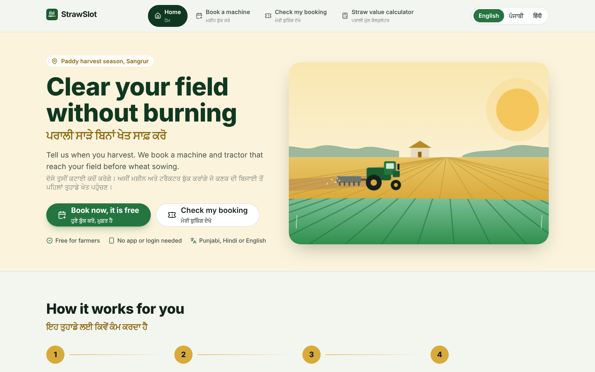<p align="center"><b>Home</b> · book in one minute, call any hiring centre</p></td>
<td width="50%">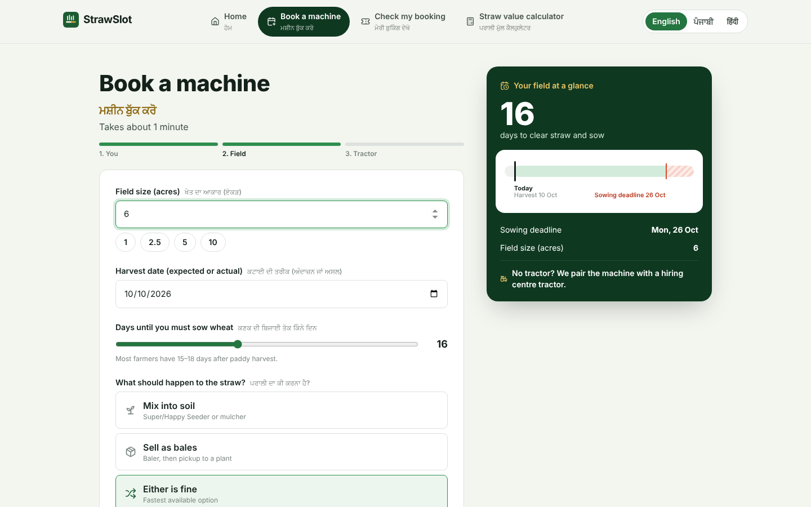<p align="center"><b>Booking</b> · live preview of the sowing window and machines your tractor can pull</p></td>
</tr>
<tr>
<td width="50%">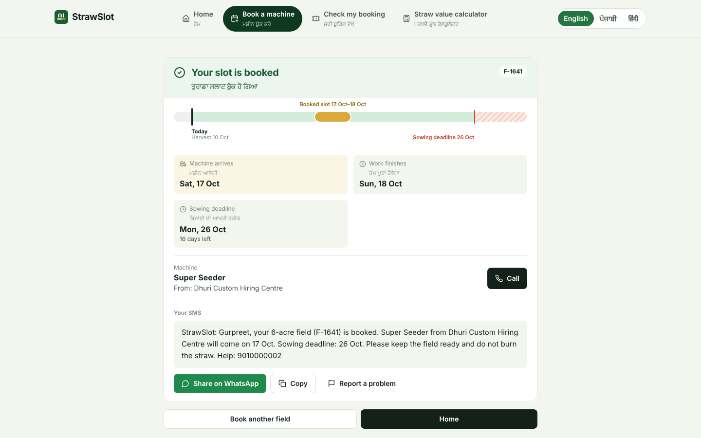<p align="center"><b>Slot booked</b> · machine date, deadline countdown, SMS and WhatsApp share</p></td>
<td width="50%">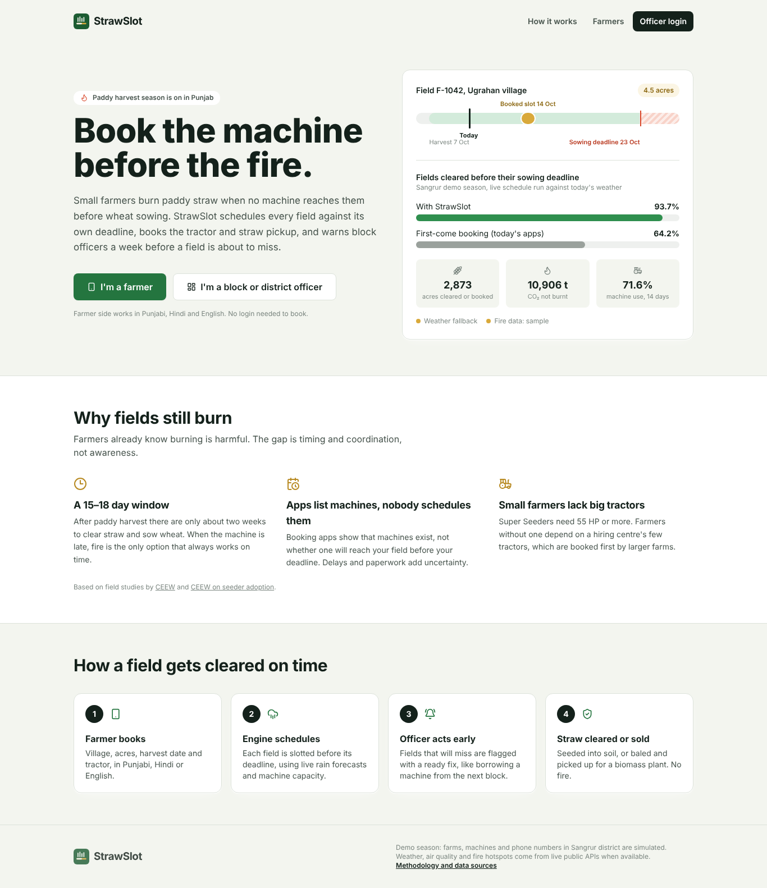<p align="center"><b>Landing</b> · StrawSlot vs first-come booking, scheduled against today's weather</p></td>
</tr>
</table>

<table>
<tr>
<td width="25%">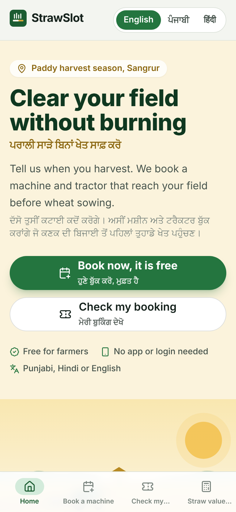</td>
<td width="25%">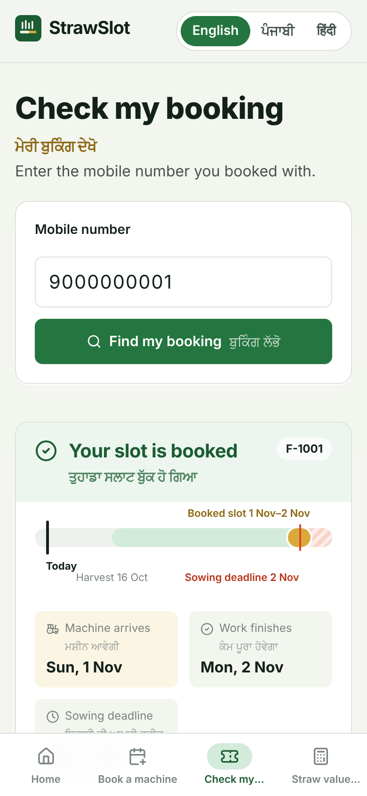</td>
<td width="50%" valign="middle">

**Built for the phone in a farmer's pocket**

- Big tap targets and a bottom menu
- English by default, Punjabi beside every heading and button
- Full ਪੰਜਾਬੀ or हिंदी in one tap
- No app install, no login, no password
- "Report a problem" goes straight to the block officer

</td>
</tr>
</table>

### Officer console · login · English / ਪੰਜਾਬੀ

<table>
<tr>
<td width="50%">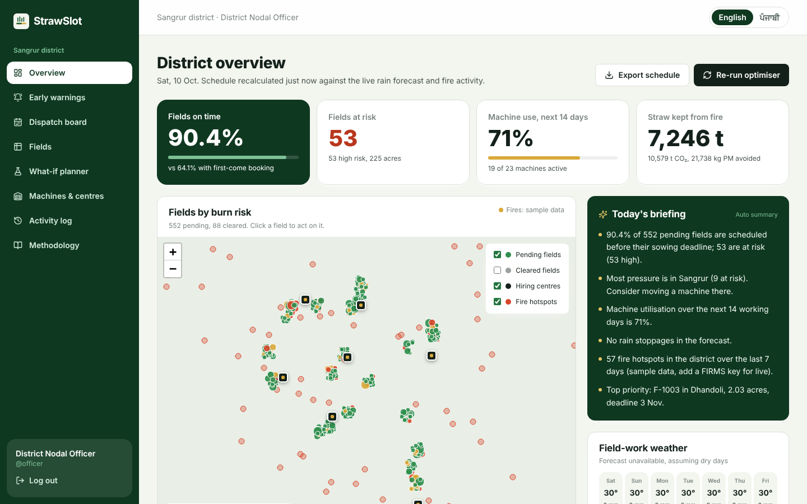<p align="center"><b>District overview</b> · risk map, fire hotspots, weather, air quality, daily briefing</p></td>
<td width="50%">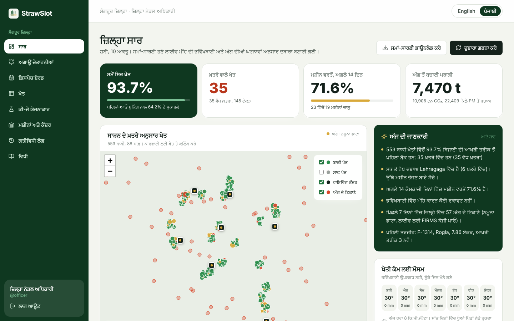<p align="center"><b>Same view in Punjabi</b> · reasons, fixes and briefing are translated too</p></td>
</tr>
<tr>
<td width="50%">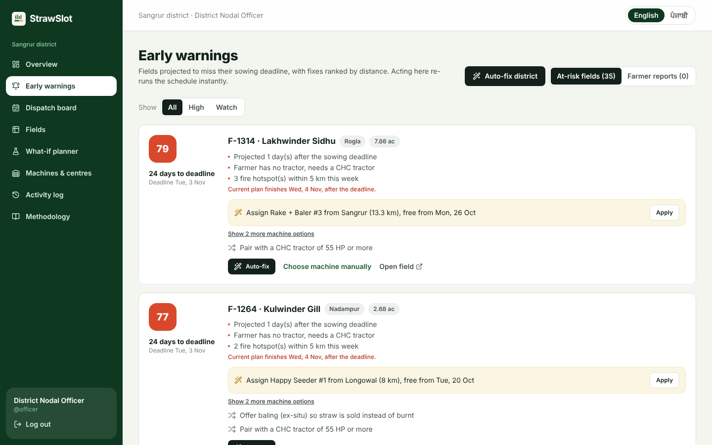<p align="center"><b>Early warnings</b> · every at-risk field with ranked fixes and Auto-fix</p></td>
<td width="50%">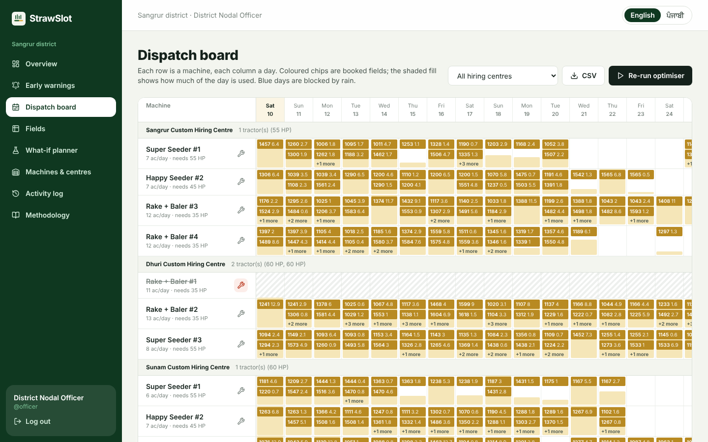<p align="center"><b>Dispatch board</b> · every machine, every day, rain days blocked</p></td>
</tr>
<tr>
<td width="50%">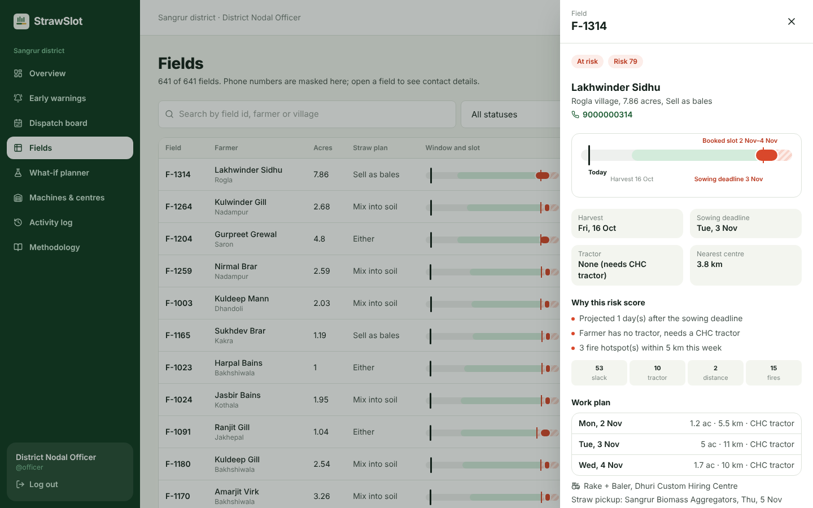<p align="center"><b>Field detail</b> · why the risk score, work plan, reassign in two clicks</p></td>
<td width="50%">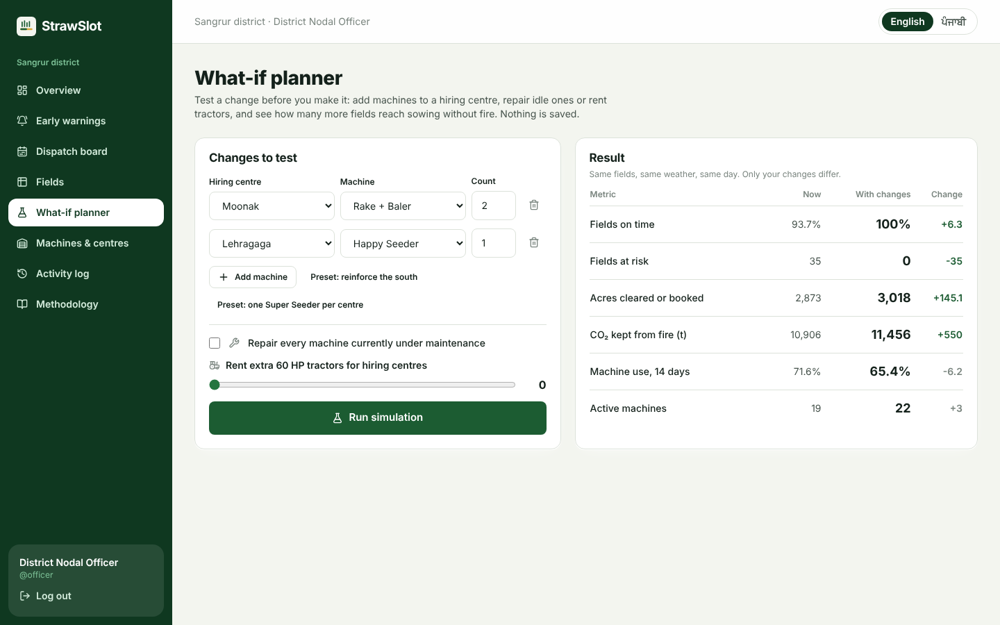<p align="center"><b>What-if planner</b> · test new machines or tractors before buying</p></td>
</tr>
</table>

> Map tiles and web fonts were blocked in the environment that took these screenshots; they load normally on the deployed site.

---

## ✨ Features

<table>
<tr>
<td width="50%" valign="top">

**For farmers**
- 3-step booking with a live sowing-window preview
- Instant slot: machine, hiring centre, date, deadline countdown
- SMS text in English, Punjabi or Hindi, with WhatsApp share
- Straw value calculator: bale income, nutrients kept, smoke avoided
- Report a late machine or changed harvest date

</td>
<td width="50%" valign="top">

**For officers**
- District KPIs, risk map, live fires, weather and PM2.5
- Daily briefing (Claude API if a key is set, rule-based otherwise)
- **Auto-fix** per field and **Auto-fix district**: only applies a change if it gets the field in on time *and* lowers the district's at-risk count
- Dispatch board, maintenance toggle, officer overrides, CSV export
- What-if planner and full activity log

</td>
</tr>
</table>

---

## 📊 Data: live vs simulated

| Data | Source | Status |
|---|---|---|
| Rain, temperature, wind (16-day) | Open-Meteo forecast API | 🟢 **Live**, no key |
| PM2.5 / US AQI (Sangrur and Delhi) | Open-Meteo air-quality API | 🟢 **Live**, no key |
| Satellite fire hotspots (VIIRS, 7 days) | NASA FIRMS | 🟢 **Live** with a free `FIRMS_MAP_KEY`, labelled sample otherwise |
| Farms, farmers, machines, hiring centres | Generated for Sangrur district | 🟡 **Simulated** (block towns use approximate real coordinates) |
| Fields booked through the app | Users | 🟢 **Real**, stored and scheduled |

Impact factors per tonne of paddy straw burnt (ICAR figures, Govt. of Goa DIP): 1,460 kg CO₂, 60 kg CO, 3 kg PM, 5.5 kg N, 25 kg K₂O. Straw yield: 2.6 t/acre.

The demo season is generated around today's date so the app always shows an active harvest. Export it with `npm run seed:export` (writes `data/demo-dataset.json` and `data/demo-fields.csv`).

> **Note:** headline results such as on-time % versus first-come booking come from the simulated Sangrur season, not from field trials.

---

<a id="judge-access"></a>

## 🧑‍⚖️ Judge access

| | Where | Login |
|---|---|---|
| 👨‍🌾 Farmer side | `/farmer` | None. Demo phone `9000000001`, or tap **Open farmer app** on the home page |
| 🏛️ Officer side | `/admin` | `officer` / `sangrur2026`. Or tap **Open demo dashboard** on the home page for one-click entry |

---

## 🏗️ Architecture

```
Browser: React 18 + TypeScript + Vite + Tailwind, Leaflet, Recharts
   │  /api/*   (typed client, retry on 502/503/504)
   ▼
Netlify Function (esbuild-bundled ESM)  ──  Express 4 + TypeScript (server/app.ts)
   │  Middleware chain
   │    request-id/logging → helmet → CORS allow-list → JSON limit → rate limiter
   │    → Zod validation → signed HMAC officer auth → 404 → central error handler
   │  Routes   public.ts · farmer.ts · admin.ts
   │  Services schedule.ts · briefing.ts
   │  Lib      engine.ts (deadlines, slot optimiser, risk, alerts, KPIs)
   │           live.ts (Open-Meteo + NASA FIRMS, cached, fallbacks) · messages.ts (pa/hi/en SMS)
   ▼
Netlify Blobs (state)   ·   local: JSON file / in-memory
```

---

<a id="run-locally"></a>

## 💻 Run locally

```bash
npm install
npm run build
npm start            # http://localhost:8787 (API + built frontend, run with tsx)
```

Development with hot reload: `npm run dev` (API on 8787, Vite on 5173).

Type-check: `npm run typecheck` (strict-ish TypeScript across server and client).

Tests: `npm test` (node:test via tsx) runs 11 engine tests covering capacity, harvest dates, tractor HP, rain blocking, officer pins, alerts, and optimiser vs baseline.

**Extras**

| Tool | Command | What it does |
|---|---|---|
| Python | `python3 analytics/season_report.py` | Recomputes season totals from the exported CSV, independent of the TypeScript engine |
| Shell | `./scripts/smoke-test.sh https://your-site.netlify.app` | Post-deploy check of health, validation, auth and the officer API |
| Docker | `docker build -t strawslot . && docker run -p 8787:8787 strawslot` | Self-host the whole app |
| GitHub Actions | `.github/workflows/ci.yml` | Typecheck, tests, build and the Python report on every push |

<details>
<summary><b>API reference</b></summary>

| Method | Path | Auth |
|---|---|---|
| GET | `/api/health`, `/api/meta`, `/api/public/stats` | public |
| GET | `/api/live/weather`, `/api/live/air`, `/api/live/fires` | public |
| POST | `/api/farmer/fields` (book), `/api/farmer/issues` (report) | public, rate-limited |
| GET | `/api/farmer/lookup?phone=` | public |
| POST | `/api/auth/login` | — |
| GET | `/api/admin/overview`, `/alerts`, `/dispatch`, `/fields`, `/registry`, `/briefing`, `/log`, `/export/schedule.csv` | officer |
| POST | `/api/admin/reassign`, `/autofix`, `/autofix-all`, `/whatif`, `/machines/:id`, `/fields/:id/status`, `/issues/:id/resolve`, `/reset` | officer |

</details>

---

## 📚 Research

- CEEW, *Why stubble burning continues in Punjab: perspectives from the ground*
- CEEW, *Why Punjab farmers are averse to using Happy/Super Seeder machines*
- The Tribune, *Satellites miss majority of stubble fires* (iFOREST report)

<div align="center">
<br/>
<sub>Built for the Cloud Counselage × DTI Social Impact Hackathon 2026 · Built with AI assistance (Claude)</sub>
</div>
